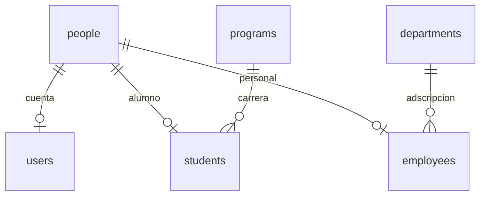

# Modelo mínimo

`people.id` es la identidad estable. `students.person_id` y `employees.person_id` son PK/FK al mismo UUID. Una persona puede tener las dos fichas y existir sin cuenta. `users.id` identifica su cuenta, no su matrícula.

## Integración

Guardar `personId` en el servicio consumidor. Si necesita la ficha escolar, ese mismo UUID identifica al alumno. Usar matrícula/empleado/usuario para encontrarlo inicialmente. Consultar el padrón cada vez que necesite nombre, correo o vínculo institucional. Cada servicio conserva sus propias calificaciones, horarios y operaciones.

| Consulta | Resultado |
| --- | --- |
| `POST /api/auth/login` | Cuenta y perfil propio; establece cookies. |
| `GET /api/auth/me` | Perfil propio completo actualizado desde la base. |
| `GET /api/people/{personId}` | Identidad institucional de otra persona; sin datos privados. |
| `GET /api/people?studentNumber=M20260001` | Busca matrícula exacta. |
| `GET /api/people?employeeNumber=D0003` | Busca empleado exacto. |
| `GET /api/people?username=alumno` | Busca cuenta exacta. |

Las consultas requieren sesión habilitada. Esta prueba usa cookies HTTPS del proyecto; no implementa SSO entre dominios ni credenciales de servicio. Antes de integrar procesos servidor a servidor, definir autenticación de clientes y permisos concretos. No compartir la clave de firma JWT con servicios consumidores.

Las cuentas comunes pueden consultar identidad institucional de otras personas, nunca CURP, RFC, nacimiento, domicilio o contacto privado. Acceso administrativo a fichas ajenas, captura, sincronización y gestión de contraseñas quedan fuera de esta entrega.

DDL: `database.sql`. Semilla opcional de desarrollo: `seed-development.sql`. Ejecutar DDL sobre una base vacía; si ya existe el esquema anterior de `users`, se requiere migración explícita. El arranque no borra ni recrea tablas.

Planes previos de tutorías, métricas y cumplimiento: `docs/legacy-service-specs/`. Son referencia histórica para servicios externos; no son módulos activos del padrón.

Arranque: [Compose y puertos](../specs/docker.spec.md). Frontend y backend tienen puertos HTTPS configurables; PostgreSQL no se publica. El volumen del proyecto conserva los registros.
